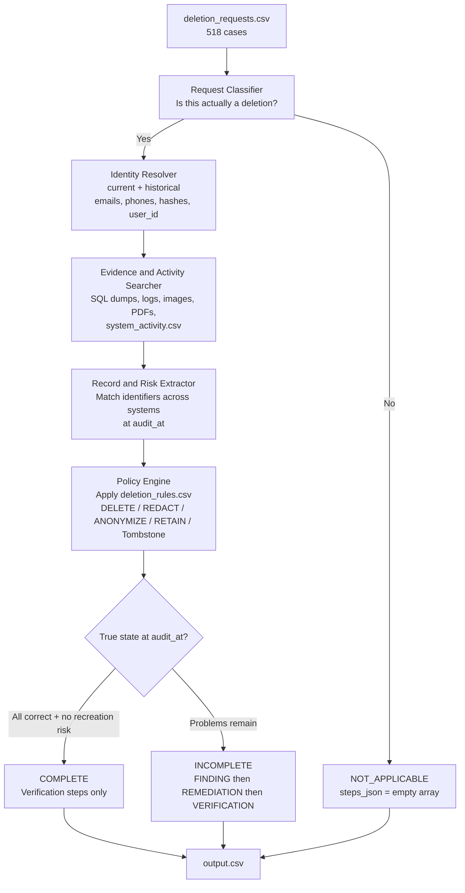
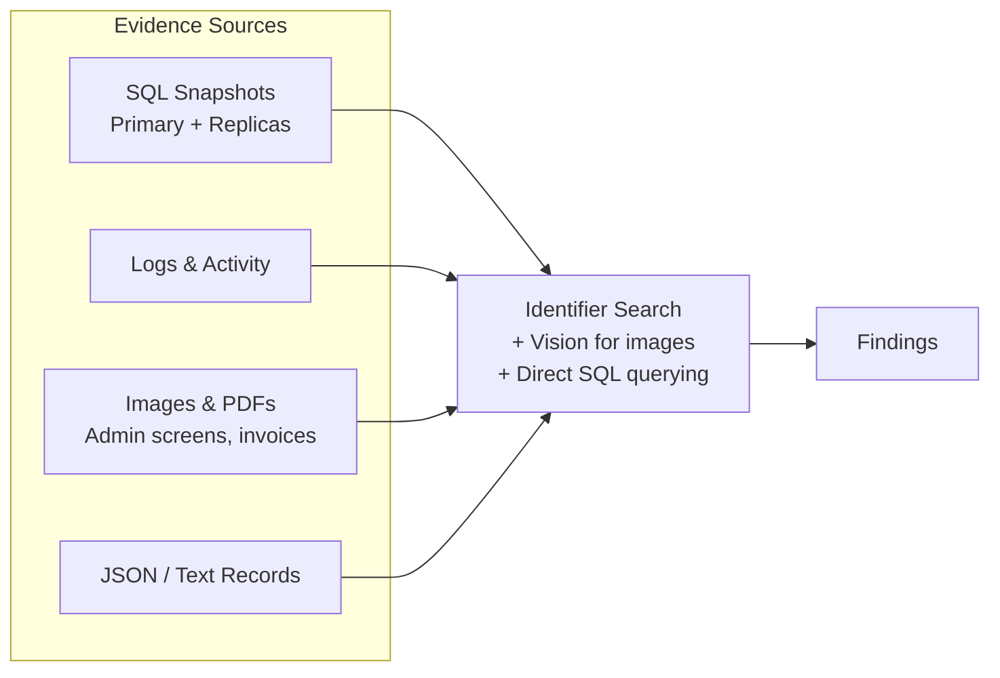

# Project Spec: Ghost Data Still Exists

> **One-line idea:**
> Build an AI-powered deletion-audit agent that determines whether a user's personal data was truly deleted from a commerce platform, identifies remaining records and recreation risks, and produces an ordered remediation and verification plan.

---

## 1. Goal

Northstar Shop lost money because a deletion workflow reported "Complete" while personal data still existed in databases, replicas, logs, support attachments, search indexes, analytics, archives, and backups. Sync and restore processes can also recreate deleted data.

The agent must process every request in `dataset/deletion_requests.csv` (518 cases), decide whether the person actually requested deletion, reconstruct the true state at `audit_at` from the supplied evidence, apply the deletion policy, and output a correctly structured answer.

**Success looks like:**
- A root-level `output.csv` with exactly 518 rows (one per `case_id`), sorted by `case_id`.
- High accuracy on deletion status (`COMPLETE`, `INCOMPLETE`, `NOT_APPLICABLE`).
- Correct, ordered, evidence-backed `steps_json` for every case.
- The solution is runnable from the terminal, uses only participant-facing data under `dataset/`, and includes the required evaluation reports.

---

## 2. Scope

### In scope
- Determining whether `request_text` actually authorizes deletion (including multilingual requests).
- Resolving current and historical identifiers for the subject.
- Searching and interpreting evidence (SQL snapshots, logs, JSON, text, PDFs, images) and `system_activity.csv` up to each case's `audit_at`.
- Applying `deletion_rules.csv` correctly, including account tombstones.
- Producing `COMPLETE`, `INCOMPLETE`, or `NOT_APPLICABLE` with the required step structure.
- Handling recreation risks (active data flows, restore paths).
- Preserving records that policy requires to be retained.
- Evaluation against sample cases and production of the required evaluation reports.

### Out of scope (explicitly)
- Using organizer-only truth, golden answers, or generator internals for predictions.
- Trusting `reported_status` or activity results as proof of state.
- Using evidence captured after a case's `audit_at`.
- Inventing additional phases, operations, or states beyond those allowed.
- Including `dataset/`, virtual environments, secrets, or sensitive data in `code.zip`.

---

## 3. Tech Stack

| Layer | Choice | Why / Notes |
| ----- | ------ | ----------- |
| Language | Python | Best ecosystem for CSV processing, SQLite, PDF/image handling, and LLM tooling. Starter entry point is already `code/main.py`. |
| LLM / Multimodal | Grok (xAI API) — `grok-4` / `grok-4.7` | Strong reasoning + native vision support. User has Premium access. Use for classification, policy reasoning, image/PDF analysis, and step generation. |
| Alternative LLM | Gemini free tier or Groq (Llama) | Zero-cost option for text stages. Use Gemini when vision is needed on free tier. |
| Data processing | pandas + sqlite3 | Load CSVs and query SQL evidence dumps directly. |
| Document / Vision | Multimodal Grok calls + pdfplumber / pymupdf | Extract text from PDFs first; send images or important PDF pages to vision only when needed. |
| Agent structure | Structured multi-stage pipeline (LangGraph optional) | Prefer deterministic stages with targeted LLM calls over a single free-form agent for reliability on 518 cases. |
| Caching | Local cache (JSON/SQLite) | Cache identity resolution, evidence extraction, and vision results. Critical for cost and speed. |
| Evaluation | Custom harness against `sample_output.csv` | Required for `evaluation/evaluation_report.md`. |

---

## 4. Architecture

The system is a multi-stage pipeline. Each stage is deterministic where possible; the LLM is used for classification, ambiguous interpretation, vision, and structured step generation.



**Evidence processing view:**



**Key decisions:**
- Do not trust `reported_status`. Reconstruct state from evidence at or before `audit_at`.
- Resolve both current and historical identifiers. The request email may be old.
- Prefer deterministic matching (identifiers, resource IDs, timestamps) before falling back to the LLM.
- Cache aggressively. Many evidence files will be relevant to multiple cases.
- For incomplete cases, disable data flows and block restores before changing dependent records.
- Findings and COMPLETE-case verification steps must cite real evidence IDs. Remediation and future verification steps use an empty `evidence_id`.

---

## 5. Core Features

### Feature: Request Classification
- **What it does:** Determines whether `request_text` authorizes deletion.
- **User flow:** Input request → classify as deletion or not.
- **Acceptance criteria:**
  - [ ] Correctly marks non-deletion requests (access, correction, export, opt-out) as `NOT_APPLICABLE` with `steps_json = []`.
  - [ ] Handles multilingual request text.
- **Notes / edge cases:** Some requests ask to inspect systems or confirm status without clearly authorizing deletion.

### Feature: Identity Resolution
- **What it does:** Expands the request email into all known current and historical identifiers.
- **Acceptance criteria:**
  - [ ] Uses `user_identities.csv` and `user_audit_log.csv`.
  - [ ] Captures user_id, emails, phones, names, and email hashes that may appear in older systems.

### Feature: Evidence Search & Extraction
- **What it does:** Finds all relevant records and risks across evidence files and `system_activity.csv`.
- **Acceptance criteria:**
  - [ ] Queries SQL dumps with sqlite3 where useful.
  - [ ] Extracts text from PDFs and analyzes images with vision when needed.
  - [ ] Respects `audit_at` cutoff.
  - [ ] Links findings to participant-visible evidence IDs (`file_id`, `activity_id`, or `audit_id`).

### Feature: Policy Application & Status Decision
- **What it does:** Applies `deletion_rules.csv` and decides `COMPLETE`, `INCOMPLETE`, or `NOT_APPLICABLE`.
- **Acceptance criteria:**
  - [ ] Correctly handles ACCOUNT_TOMBSTONE (preserve stable user_id, remove direct identifiers).
  - [ ] Reports remaining records, exposed PII, active data flows, and restore risks.
  - [ ] Only marks COMPLETE when every relevant copy has the required treatment and no recreation path exists.

### Feature: Step Generation
- **What it does:** Produces the ordered `steps_json` array.
- **Acceptance criteria:**
  - [ ] Phases in order: FINDING → REMEDIATION → VERIFICATION.
  - [ ] Steps numbered consecutively from 1.
  - [ ] Uses only allowed operations and states.
  - [ ] COMPLETE cases contain only verification steps with evidence citations.
  - [ ] INCOMPLETE cases contain findings, full remediation plan, and post-remediation verification steps (empty evidence_id on future work).

### Feature: Evaluation & Reporting
- **What it does:** Measures performance on sample cases and documents usage.
- **Acceptance criteria:**
  - [ ] Produces `evaluation/evaluation_report.md` with accuracy metrics and at least three custom cases.
  - [ ] Produces `evaluation/usage_report.md` with model calls, tokens, and estimated cost for the full run.

---

## 6. Data Model

Primary inputs (all under `dataset/`):

- **deletion_requests.csv**: case_id, email, requested_at, reported_status, reported_at, audit_at, request_text
- **user_identities.csv**: current identity snapshot
- **user_audit_log.csv**: historical identity changes
- **system_activity.csv**: global stream of deletion, sync, export, backup, restore, indexing events
- **deletion_rules.csv**: required action per data category and condition
- **evidence_files.csv**: manifest mapping file_id → path, origin, captured_at
- **evidence/**: databases (SQL), documents, images, logs, records

Output:
- **output.csv** (repository root): case_id, deletion_status, steps_json

Step object schema:
```json
{
  "step_no": 1,
  "phase": "FINDING",
  "system_id": "account_service",
  "resource_id": "account_005",
  "operation": "REPORT_REMAINING_RECORD",
  "state": "PRESENT",
  "evidence_id": "evidence_01"
}
```

---

## 7. APIs / Interfaces

The solution is a batch process, not a service. Main interfaces:

| Interface | Purpose | Notes |
| --------- | ------- | ----- |
| `code/main.py` (or documented entry point) | Process all 518 cases and write root `output.csv` | Must be runnable from the terminal |
| xAI API | LLM + vision calls | Read API key from environment variable |
| Local cache | Avoid re-processing evidence | JSON or SQLite |

---

## 8. Non-Functional Requirements

- **Performance:** Must complete all 518 cases in a reasonable time. Aggressive caching is required.
- **Cost:** Track token usage. Prefer deterministic code for matching; use the LLM only where needed. Cache vision results.
- **Determinism:** Ordering of steps and JSON serialization should be stable.
- **Correctness:** Never use evidence after `audit_at`. Never invent operations or states.
- **Security:** Never commit API keys. Read secrets from environment variables only.
- **Reproducibility:** A clean run should produce a valid `output.csv`.

---

## 9. Coding Conventions (for the AI agent)

- Language: Python 3.11+
- Style: Clear, modular functions. Prefer readable code over clever one-liners.
- File structure suggestion:
  ```
  code/
  ├── main.py
  ├── classifier.py
  ├── identity.py
  ├── evidence.py
  ├── policy.py
  ├── steps.py
  ├── cache.py
  └── evaluation/
  ```
- Naming: snake_case for functions and variables.
- Error handling: Fail clearly with context. Log which case and stage failed.
- Testing: Continuously compare against the 32 sample cases before running the full set.
- What to avoid: Hardcoding golden answers, using organizer-only files, trusting reported_status, processing evidence after audit_at.

---

## 10. Development Phases

| Phase | Scope | Done when |
| ----- | ----- | --------- |
| 1 | Understand problem, study sample cases, set up project structure and caching | Agent can load data and explain one sample case end-to-end |
| 2 | Identity resolution + request classification | Correctly classifies sample requests and expands identifiers |
| 3 | Evidence search (text + SQL + vision) | Finds relevant evidence for sample cases with correct citations |
| 4 | Policy engine + status decision | Matches sample deletion_status on most cases |
| 5 | Step generation | Produces valid, ordered steps_json that closely matches samples |
| 6 | Full evaluation loop + 518-case run | Valid output.csv + evaluation reports written |
| 7 | Packaging | code.zip and supporting files ready for submission |

---

## 11. Open Questions / Decisions Still Needed

- Exact Grok model name and vision call pattern to standardize on.
- How aggressively to use vision vs. text extraction for PDFs.
- Whether to pre-index all evidence or search on demand per case.
- Preferred caching strategy (file-based JSON vs. SQLite).
- How to handle ambiguous multilingual requests that are not clearly deletions.

---

## 12. References

- Official challenge: https://www.hackerrank.com/contests/hackerrank-orchestrate-october26/challenges/ghost-data-still-exists
- Repository: https://github.com/alvarozs-0/hackerrank-orchestrate-october26
- Key files: `problem_statement.md`, `AGENTS.md`, `dataset/deletion_rules.csv`, `dataset/sample_output.csv`
- Allowed step operations and states are fully defined in the problem statement and AGENTS.md.
