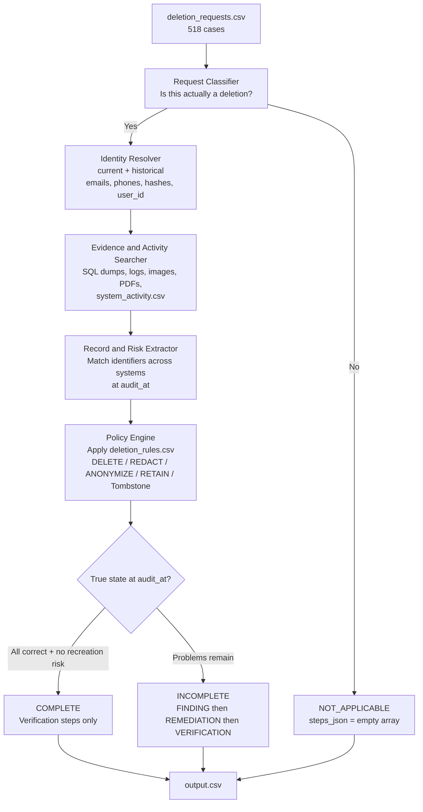
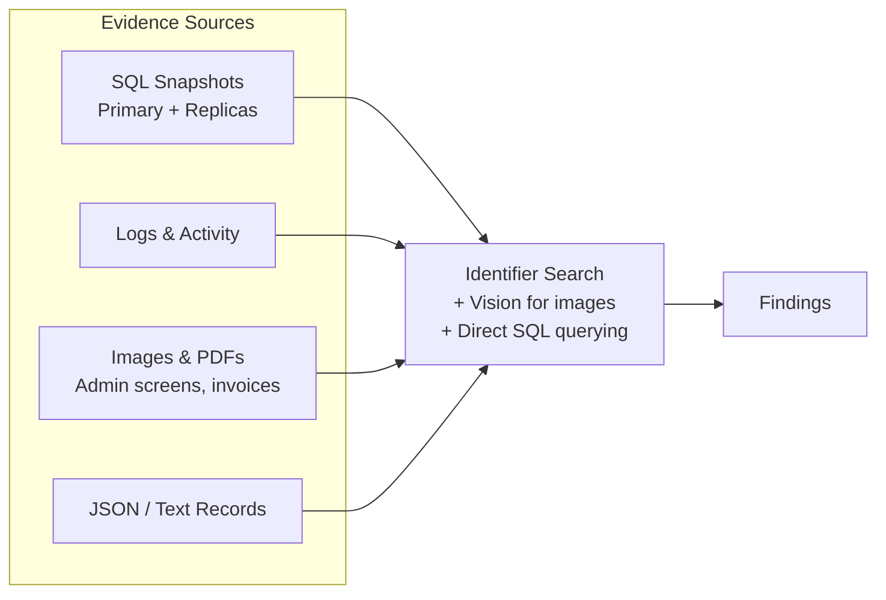

# Project Spec: Ghost Data Still Exists

> **One-line idea:**
> Build an AI-powered deletion-audit agent that determines whether a user's personal data was truly deleted from a commerce platform, identifies remaining records and recreation risks, and produces an ordered remediation and verification plan.

---

## 1. Goal

Northstar Shop lost money because a deletion workflow reported "Complete" while personal data still existed in databases, replicas, logs, support attachments, search indexes, analytics, archives, and backups. Sync and restore processes can also recreate deleted data.

The agent must process every request in `dataset/deletion_requests.csv` (518 cases), decide whether the person actually requested deletion, reconstruct the true state at `audit_at` from the supplied evidence, apply the deletion policy, and output a correctly structured answer.

The contract is `problem_statement.md` and `AGENTS.md` §6. This file may only decide what those leave open. If they disagree, they win.

**Success looks like:**
- A root-level `output.csv` with exactly 518 rows (one per `case_id`), sorted by `case_id`.
- High accuracy on deletion status (`COMPLETE`, `INCOMPLETE`, `NOT_APPLICABLE`).
- Correct, ordered, evidence-backed `steps_json` for every case.
- The solution is runnable from the terminal, uses only participant-facing data under `dataset/`, and includes the required evaluation reports.

---

## 2. Scope

### In scope
- Determining whether `request_text` actually authorizes deletion (including multilingual requests).
- Resolving current and historical identifiers for the subject.
- Searching and interpreting evidence (SQL snapshots, logs, JSON, text, PDFs, images) and `system_activity.csv` up to each case's `audit_at`.
- Applying `deletion_rules.csv` correctly, including account tombstones.
- Producing `COMPLETE`, `INCOMPLETE`, or `NOT_APPLICABLE` with the required step structure.
- Handling recreation risks (active data flows, restore paths).
- Preserving records that policy requires to be retained.
- Evaluation against sample cases and production of the required evaluation reports.

### Out of scope (explicitly)
- Using organizer-only truth, golden answers, or generator internals for predictions.
- Trusting `reported_status` or activity results as proof of state.
- Using evidence captured after a case's `audit_at`.
- Inventing additional phases, operations, or states beyond those allowed.
- Including `dataset/`, virtual environments, secrets, or sensitive data in `code.zip`.

---

## 3. Tech Stack

| Layer | Choice | Why / Notes |
| ----- | ------ | ----------- |
| Language | Python | Best ecosystem for CSV processing, SQLite, PDF/image handling, and LLM tooling. Starter entry point is already `code/main.py`. |
| LLM / Multimodal | xAI Grok 4 family | Fact extraction only. Does not choose `deletion_status` or write `steps_json`. See ADR-0001. Model id comes from the environment. Default is `grok-4.7`. Any id starting with `grok-4` is allowed. `grok-build-0.1` is not. |
| Alternative LLM | Env fallback list, empty by default | Fact extraction only, and only when the primary Grok 4 call fails. Never chooses status or writes steps. Do not hardcode Gemini or Groq. |
| Data processing | pandas + sqlite3 | Load CSVs and query SQL evidence dumps directly. |
| Document / Vision | pdfplumber / pymupdf, then vision | Text-extract PDFs first. Vision only for screenshots and PDF pages with no usable text. |
| Agent structure | Structured multi-stage pipeline (LangGraph optional) | Prefer deterministic stages with targeted LLM calls over a single free-form agent for reliability on 518 cases. |
| Caching | Local SQLite | Cache identity resolution, evidence extraction, and vision results. Critical for cost and speed. |
| Evaluation | Custom harness against `sample_output.csv` | Required for `evaluation/evaluation_report.md`. |

---

## 4. Architecture

The system is a multi-stage pipeline. Status and steps are deterministic. The model may only extract facts that code cannot establish from structured fields. It must not choose `deletion_status` or write `steps_json`. See `docs/adr/0001-deterministic-policy-engine.md`.



**Evidence processing view:**



**Key decisions:**
- Do not trust `reported_status`. Reconstruct state from evidence at or before `audit_at`.
- Resolve both current and historical identifiers. The request email may be old.
- A resource is relevant only through a grounded link. One cross-reference hop counts. A second hop does not. A deletion-worker timestamp is not a link. An unlinked sample resource, such as `analytics_901` or `account_4857`, stays out rather than being guessed.
- A category printed on a record is authoritative. A resource prefix determines `system_id` only, never a `deletion_rules.csv` category.
- Two tables in one SQL file are two copies. An absent primary does not cancel a live replica.
- A deletion request includes a request to delete, erase, or close the account, and a request to inspect, confirm, or verify that deletion. A different action with no deletion ask is `NOT_APPLICABLE`.
- The model does not choose status or write steps. See ADR-0001. It consumes only typed facts.
- Code decides whether `request_text` is a deletion request. A model is called only when the text matches neither a deletion pattern nor a known non-deletion pattern. See ADR-0002.
- Cite a `file_id` when a file captured at or before `audit_at` proves the step. If several files prove it, cite the latest `captured_at`, then the lowest `file_id`. See ADR-0003. Cite an `activity_id` or `audit_id` only when no such file exists. That tie-break does not drop an older snapshot that still shows prohibited data.
- Unmatched `request_text` is a deletion request only when a model returns yes. Otherwise it is `NOT_APPLICABLE`.
- A fallback model runs only when the primary Grok 4 call fails. The fallback list comes from the environment and is empty by default. If a required extraction still fails, the run exits non-zero and does not write `output.csv`.
- Model extraction returns only typed fields: identifiers seen, `system_id`, `resource_id`, a printed `deletion_rules.csv` category, and a state observation. It does not return a status, an operation, or a free-text finding.
- Absence may be an explicit miss, or omission from the snapshot that should hold the record. The cited file need not contain the resource string.
- The three required custom evaluation cases are one explicit non-deletion request, one tombstone that still exposes PII, and one sync or restore that can recreate deleted data.
- Parse and index all 94 evidence files once, then resolve each case from that index plus the CSVs.
- Cache extracted facts in local SQLite.
- Text-extract PDFs. Use vision only for screenshots and for PDF pages with no usable text.
- Do not run the 518-case file until all 32 sample rows match on status and ordered steps.
- Within each phase, order steps by the operation table, then `system_id`, then `resource_id`.
- An account tombstone is `REDACT`: keep `user_id`; remove name, email, phone, and email hash. Do not invent a tombstone operation.
- For incomplete cases, findings cover violations only. Remediation repeats those violations in operation-table order: disable data flows and block restores before changing records. Verification lists the required end state of every relevant record and risk, including ones that were already compliant, with an empty `evidence_id`.
- A `DELETE` record that still exists is `REPORT_REMAINING_RECORD`. A `REDACT` or `ANONYMIZE` record that still has direct identifiers is `REPORT_EXPOSED_PII`. A compliant `RETAIN` record is not a finding. Active copy processes are `REPORT_ACTIVE_DATA_FLOW`. Restorable backups are `REPORT_RESTORE_RISK`.
- If no rule covers a relevant record, or it has no printed category, the run stops. Do not invent a `DELETE`. See ADR-0004.
- A present security audit with no `retention_until` is still within retention. An explicit `retention_until` before `audit_at` stops the run. A missing legal-hold flag stops the run.
- Findings and COMPLETE-case verification steps must cite real evidence IDs. Remediation and future verification steps use an empty `evidence_id`.

---

## 5. Core Features

### Feature: Request Classification
- **What it does:** Determines whether `request_text` authorizes deletion.
- **User flow:** Input request → classify as deletion or not.
- **Acceptance criteria:**
  - [ ] Correctly marks non-deletion requests (access, correction, export, opt-out) as `NOT_APPLICABLE` with `steps_json = []`.
  - [ ] Handles multilingual request text with the same rule. Language is not a special case.
  - [ ] Decides known deletion and non-deletion patterns in code. Calls a model only for unmatched wording. A no or an uncertain answer is `NOT_APPLICABLE`.
- **Notes / edge cases:** Inspect, confirm, or verify wording about a deletion is still a deletion request. Samples `case_25`, `case_26`, and `case_28` are `COMPLETE`, not `NOT_APPLICABLE`.

### Feature: Identity Resolution
- **What it does:** Expands the request email into all known current and historical identifiers.
- **Acceptance criteria:**
  - [ ] Uses `user_identities.csv` and `user_audit_log.csv`.
  - [ ] Captures user_id, emails, phones, names, and email hashes that may appear in older systems.

### Feature: Evidence Search & Extraction
- **What it does:** Finds all relevant records and risks across evidence files and `system_activity.csv`.
- **Acceptance criteria:**
  - [ ] Queries SQL dumps with sqlite3 where useful.
  - [ ] Extracts text from PDFs and analyzes images with vision when needed.
  - [ ] Respects `audit_at` cutoff.
  - [ ] Links findings to participant-visible evidence IDs (`file_id`, `activity_id`, or `audit_id`).

### Feature: Policy Application & Status Decision
- **What it does:** Applies `deletion_rules.csv` and decides `COMPLETE`, `INCOMPLETE`, or `NOT_APPLICABLE`.
- **Acceptance criteria:**
  - [ ] Handles ACCOUNT_TOMBSTONE as REDACT: preserve stable user_id, remove direct identifiers. Do not invent a tombstone operation.
  - [ ] Reports remaining records, exposed PII, active data flows, and restore risks.
  - [ ] Only marks COMPLETE when every relevant copy has the required treatment and no recreation path exists.

### Feature: Step Generation
- **What it does:** Produces the ordered `steps_json` array.
- **Acceptance criteria:**
  - [ ] Phases in order: FINDING → REMEDIATION → VERIFICATION. Within a phase, operation-table order, then `system_id`, then `resource_id`.
  - [ ] Steps are emitted by the policy engine, not by a model.
  - [ ] Steps numbered consecutively from 1.
  - [ ] Uses only allowed operations and states.
  - [ ] COMPLETE cases contain only verification steps with evidence citations.
  - [ ] INCOMPLETE cases contain findings, full remediation plan, and post-remediation verification steps (empty evidence_id on future work).

### Feature: Evaluation & Reporting
- **What it does:** Measures performance on sample cases and documents usage.
- **Acceptance criteria:**
  - [ ] Produces `evaluation/evaluation_report.md` with accuracy metrics and at least three custom cases: one explicit non-deletion request, one tombstone that still exposes PII, and one sync or restore that can recreate deleted data.
  - [ ] Produces `evaluation/usage_report.md` with model calls, tokens, and estimated cost for the full run.

---

## 6. Data Model

Primary inputs (all under `dataset/`):

- **deletion_requests.csv**: case_id, email, requested_at, reported_status, reported_at, audit_at, request_text
- **user_identities.csv**: current identity snapshot
- **user_audit_log.csv**: historical identity changes
- **system_activity.csv**: global stream of deletion, sync, export, backup, restore, indexing events
- **deletion_rules.csv**: required action per data category and condition
- **evidence_files.csv**: manifest mapping file_id → path, origin, captured_at
- **evidence/**: databases (SQL), documents, images, logs, records

Output:
- **output.csv** (repository root): case_id, deletion_status, steps_json

Step object schema:
```json
{
  "step_no": 1,
  "phase": "FINDING",
  "system_id": "account_service",
  "resource_id": "account_005",
  "operation": "REPORT_REMAINING_RECORD",
  "state": "PRESENT",
  "evidence_id": "evidence_01"
}
```

---

## 7. APIs / Interfaces

The solution is a batch process, not a service. Main interfaces:

| Interface | Purpose | Notes |
| --------- | ------- | ----- |
| `code/main.py` (or documented entry point) | Process all 518 cases and write root `output.csv` | Must be runnable from the terminal |
| xAI API | LLM + vision calls | Read API key from environment variable |
| Local cache | Avoid re-processing evidence | JSON or SQLite |

---

## 8. Non-Functional Requirements

- **Performance:** Must complete all 518 cases in a reasonable time. Aggressive caching is required.
- **Cost:** Track token usage. Prefer deterministic code for matching; use the LLM only where needed. Cache vision results.
- **Determinism:** Ordering of steps and JSON serialization must be stable. Within a phase, follow the operation-table order, then `system_id`, then `resource_id` ascending.
- **Correctness:** Never use evidence after `audit_at`. Never invent operations or states.
- **Security:** Never commit API keys. Read secrets from environment variables only.
- **Reproducibility:** A clean run should produce a valid `output.csv`.

---

## 9. Coding Conventions (for the AI agent)

- Language: Python 3.11+
- Style: Clear, modular functions. Prefer readable code over clever one-liners.
- File structure suggestion:
  ```
  code/
  ├── main.py
  ├── classifier.py
  ├── identity.py
  ├── evidence.py
  ├── policy.py
  ├── steps.py
  ├── cache.py
  └── evaluation/
  ```
- Naming: snake_case for functions and variables.
- Error handling: Fail clearly with context. Log which case and stage failed.
- Testing: Continuously compare against the 32 sample cases before running the full set.
- What to avoid: Hardcoding golden answers, using organizer-only files, trusting reported_status, processing evidence after audit_at.

---

## 10. Development Phases

| Phase | Scope | Done when |
| ----- | ----- | --------- |
| 1 | Understand problem, study sample cases, set up project structure and caching | Agent can load data and explain one sample case end-to-end |
| 2 | Identity resolution + request classification | Correctly classifies sample requests and expands identifiers |
| 3 | Evidence search (text + SQL + vision) | Finds relevant evidence for sample cases with correct citations |
| 4 | Policy engine + status decision | Matches sample deletion_status on all 32 rows |
| 5 | Step generation | Ordered steps_json matches all 32 sample rows on phase, operation, state, system, resource, and evidence id |
| 6 | Full evaluation loop + 518-case run | Starts only after phase 5 matches. Valid output.csv + evaluation reports written |
| 7 | Packaging | code.zip and supporting files ready for submission |

---

## 11. Open Questions / Decisions Still Needed

Settled in the grill, and recorded above:

- Contract beats this file.
- Status and steps come from a deterministic policy engine (ADR-0001).
- SQLite cache, pre-indexed evidence, vision only when text cannot see the artifact.
- Sample exact-match gates the 518-case run.
- A deletion request includes inspect, confirm, or verify of a deletion (ADR-0002).
- An account tombstone is REDACT, not a fifth action.
- Authorization of known wording is a rule. A model sees only unmatched text.
- The policy engine consumes only typed facts.
- Cite a file when one proves the step. Absence includes omission from the relevant snapshot.
- Custom cases cover non-deletion, an exposed tombstone, and a recreation path.
- Primary model is any xAI id starting with `grok-4`, from the environment, default `grok-4.7`.
- Fallbacks are an environment list, empty by default, and run only when the primary call fails.
- Unmatched wording is `NOT_APPLICABLE` unless the model affirms a deletion request.
- Several proving files: latest `captured_at`, then lowest `file_id` (ADR-0003).
- A required extraction that fails, with no fallback answer, aborts the run. No guessed status and no partial `output.csv`.
- Extraction fields are identifiers, `system_id`, `resource_id`, a printed category, and a state observation. No verdict.
- A resource is relevant only through a grounded link (ADR-0005). Unlinked resources are omitted, not guessed.
- A printed category beats the resource prefix. No printed category stops the run (ADR-0004).
- Two tables in one SQL file are two copies.
- Incomplete verification covers the full end state, not only the findings.
- The finding operation follows the required action.
- Fail-closed extraction and unmatched rules stop the run (ADR-0004).

Confirmed by the user. The grill frontier is empty.

---

## 12. References

- Official challenge: https://www.hackerrank.com/contests/hackerrank-orchestrate-october26/challenges/ghost-data-still-exists
- Repository: https://github.com/alvarozs-0/hackerrank-orchestrate-october26
- Key files: `problem_statement.md`, `AGENTS.md`, `dataset/deletion_rules.csv`, `dataset/sample_output.csv`
- Allowed step operations and states are fully defined in the problem statement and AGENTS.md.
